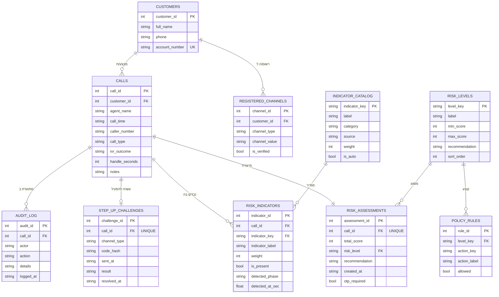

# תרשים ERD - VeriCall (אימות מבוסס סיכון במוקד שירות בנקאי)

> קובץ התמונה להגשה: [docs/erd.png](docs/erd.png)

## 1. ישויות מרכזיות

| ישות | טבלה | תפקיד |
|---|---|---|
| **Customer** | `customers` | הלקוח שבשמו מתנהלת השיחה |
| **RegisteredChannel** | `registered_channels` | ערוצים רשומים של הלקוח (אפליקציה / מספר) - היעד ל-Step-Up בערוץ **בלתי-תלוי** |
| **Call** | `calls` | שיחה בודדת; כולל מספר מתקשר, תוצאת IVR, זמן טיפול וסוג (ידני/חי) |
| **IndicatorCatalog** | `indicator_catalog` | קטלוג אינדיקציות: משקל, קטגוריה, **מקור הנתון** - ניתן לכיול ללא שינוי קוד |
| **RiskIndicator** | `risk_indicators` | אינדיקציה שנבדקה בשיחה: האם זוהתה, באיזה שלב (IVR/נציג) ובאיזו שנייה |
| **RiskLevel** | `risk_levels` | ספי הרמות (נמוך/בינוני/גבוה) והמלצה לכל רמה |
| **RiskAssessment** | `risk_assessments` | תוצאת החישוב הסופי לשיחה: ציון, רמה, המלצה |
| **PolicyRule** | `policy_rules` | מטריצת פעולות מותרות/חסומות לכל רמת סיכון |
| **StepUpChallenge** | `step_up_challenges` | אתגר Step-Up: ערוץ, hash של הקוד, זמן שליחה, **תוצאה** |
| **AuditLog** | `audit_log` | יומן ביקורת: כל החלטת מערכת וכל פעולת נציג |

## 2. תרשים (Mermaid)

## 3. מפתחות וקשרים

| קשר | סוג | הסבר |
|---|---|---|
| Customer → Call | **1:N** | ללקוח אחד מספר שיחות; מאפשר זיהוי פניות חוזרות |
| Customer → RegisteredChannel | **1:N** | ללקוח כמה ערוצים רשומים (אפליקציה, מספר) |
| Call → RiskIndicator | **1:N** | לכל שיחה נשמרות כל האינדיקציות שנבדקו (זוהו או לא) |
| IndicatorCatalog → RiskIndicator | **1:N** | כל אינדיקציה בשיחה מפנה להגדרתה בקטלוג (משקל, מקור) |
| Call → RiskAssessment | **1:1** | לכל שיחה הערכה סופית אחת (`call_id UNIQUE`) |
| RiskLevel → RiskAssessment | **1:N** | ההערכה מסווגת לרמה אחת מתוך הספים |
| RiskLevel → PolicyRule | **1:N** | לכל רמה מספר כללי מדיניות (פעולה ← מותר/חסום) |
| Call → StepUpChallenge | **1:0..1** | לא לכל שיחה נשלח Step-Up (רק בבינוני) |
| Call → AuditLog | **1:N** | כל שיחה מייצרת מספר רשומות ביקורת |

## 4. כיצד ה-ERD תומך בפונקציונליות המערכת

1. **כיול ללא קוד** (`indicator_catalog`, `risk_levels`) - Wiefling et al. (2021): "אין תצורת RBA אחת שמתאימה לכל שירות". משקלים וספים בטבלה, לא בקוד.
2. **תיעוד מקור האות** (`indicator_catalog.source`) - הסקירה: "להשתמש רק בנתונים חוקיים, רלוונטיים ואמינים, ולתעד את מקורם".
3. **X-Factor: שלב הזיהוי** (`risk_indicators.detected_phase`, `detected_at_sec`) - מתעד אילו אותות זוהו **בשלב ה-IVR** לפני שהנציג ענה. זה הנתון שמוכיח את ניצול זמן ההמתנה.
4. **Step-Up בערוץ בלתי-תלוי** (`registered_channels`, `step_up_challenges.channel_type`) - הקוד נשלח לערוץ רשום, לא למספר המתקשר.
5. **הקוד נשמר כ-hash בלבד** (`code_hash`) - לא חושפים למתקשר/לנציג מידע שמאפשר לעקוף את המודל.
6. **סגירת הלופ** (`step_up_challenges.result`) - תוצאת Step-Up (אושר/נכשל) מתועדת ומשפיעה על הציון הסופי.
7. **תמיכה בהחלטה, לא החלפתה** (`policy_rules`) - הנציג רואה מה מותר; המערכת מגבילה, לא מחליטה.
8. **Audit Log** (`audit_log`) - הסקירה: "לתעד ציון, רמה, תוצאות אימות ופעולה שננקטה" - לתחקור, בקרה ושיפור הכיול.
9. **מדדי הצלחה** (`calls.handle_seconds`, `step_up_challenges.result`) - מאפשרים לחשב זמן טיפול לפי רמה, שיעור False-Positive ושיעור השלמת Step-Up (Gunson 2011).
